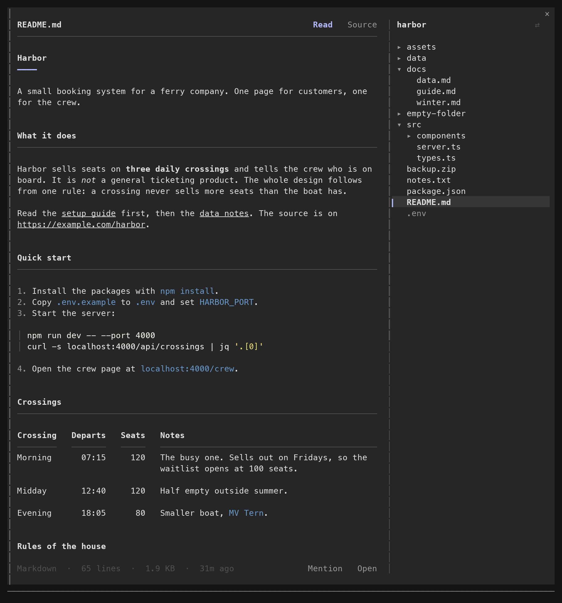

# folio

A Claude Code mod. `/files` opens a pane beside the chat with the files of your project. Markdown shows as a document, with headings, tables and paragraphs that wrap.


The document is next to the chat. The file tree is at the right edge. The prompt stays where it is, at the bottom.

## Install

In a Claude Code terminal session:

```
/plugin install folio --marketplace krishna-goutham-tls/folio
```

Answer `y` to add the marketplace, then pick a scope. The user scope loads folio in every session. Then type `/files`.

folio is built and tested on Claude Code 2.1.295. Mods are early access, so a later release can change the API and break it.

## Use it

| You do | The pane does |
|---|---|
| `/files` | Opens, and shows the README of the project |
| `/files docs/guide.md` | Opens that file and its folder |
| Click a folder | Opens or closes it |
| Click a file | Shows it |
| Scroll over the document or the tree | Moves that part only |
| Click `Read` or `Source` | Shows the formatted document or the text as written |
| Click a link to a file of the project | Opens that file |
| Click `Mention` | Puts `@path` in the prompt |
| Click `Open` | Opens the file in its Mac app |
| Click `⇄` | Moves the tree to the other side |

`ctrl+x tab` gives the pane the keyboard. The arrows and the page keys move the document, Tab walks the rows, and Enter opens one. Esc returns to the prompt.

## What it shows

| File | How |
|---|---|
| Markdown | Headings, paragraphs that wrap, lists, task lists, quotes, tables, code blocks with colours, front matter |
| Code and text | Claude Code's syntax colours, with line numbers |
| CSV and TSV | A table |
| PNG, JPG, GIF, HEIC | The picture, in a terminal with the kitty graphics protocol such as Ghostty or kitty |
| PDF, Office files, SVG | The first page as a picture, made by macOS Quick Look |
| `.env`, keys, credentials | A notice. The text stays hidden until you click `Reveal`, so a shared screen or a recording is safe |
| Other files | The name and size. `Open` shows the file in its own app |

A file that Claude writes gets a `●` in the tree. The open document reads the disk again when a turn ends.

The pane follows your light or dark theme.



## What it can reach

A mod runs inside Claude Code, so it is fair to ask what this one does.

- It reads files under the project folder, and only to show them in the pane. The text does not go to the model.
- It writes nothing in your project.
- It makes no network call.
- It runs five macOS programs: `sips` and `qlmanage` to make a picture preview, `mkdir` and `mv` for that preview in the temp folder, and `open` when you click `Open`.
- It watches the Edit and Write tools to mark the files Claude wrote. It never changes or blocks a tool call.
- It keeps the open folders and the open file of each project in Claude Code's plugin store, on your machine.

`claude plugin validate .` prints the same list from the source.

## Limits

- It only reads. There is no edit mode yet. `Mention` puts the path in the prompt so you can ask Claude for the change.
- It is for the terminal. The desktop app is not done.
- The pane docks beside the chat in the fullscreen layout, on a terminal 110 columns wide or more. Elsewhere it opens above the prompt.
- The tree and the document show side by side when the pane is 84 columns wide or more. A narrower pane shows one of them at a time.
- Pictures are the least tested part. They need macOS and a terminal with the kitty graphics protocol.
- A file changed by a shell command gets its `●` only when its folder is open in the tree.

Open work is in `TRACKER.md`.

## How it works

- `hooks/register.tsx` has the hooks and every read of the disk.
- `hooks/markdown.ts` turns markdown into rows, one per terminal line. The pane draws only the rows in view, so a long file scrolls like a short one.
- `hooks/view.tsx` draws the tree and the reader.
- The pane keeps its own scroll position for the tree and for the document. That is how the header and the tree stay in place while the document moves.

## Work on it

```sh
git clone https://github.com/krishna-goutham-tls/folio
cd folio
claude --plugin-dir .
```

Claude Code loads the mod from the folder and reloads it when you save a file. It also writes the API types to `.claude-plugin/types/`, which the `tsconfig.json` here reads.

```sh
claude plugin validate .
claude plugin test .
npx -p typescript tsc -p .
```

## License

MIT
