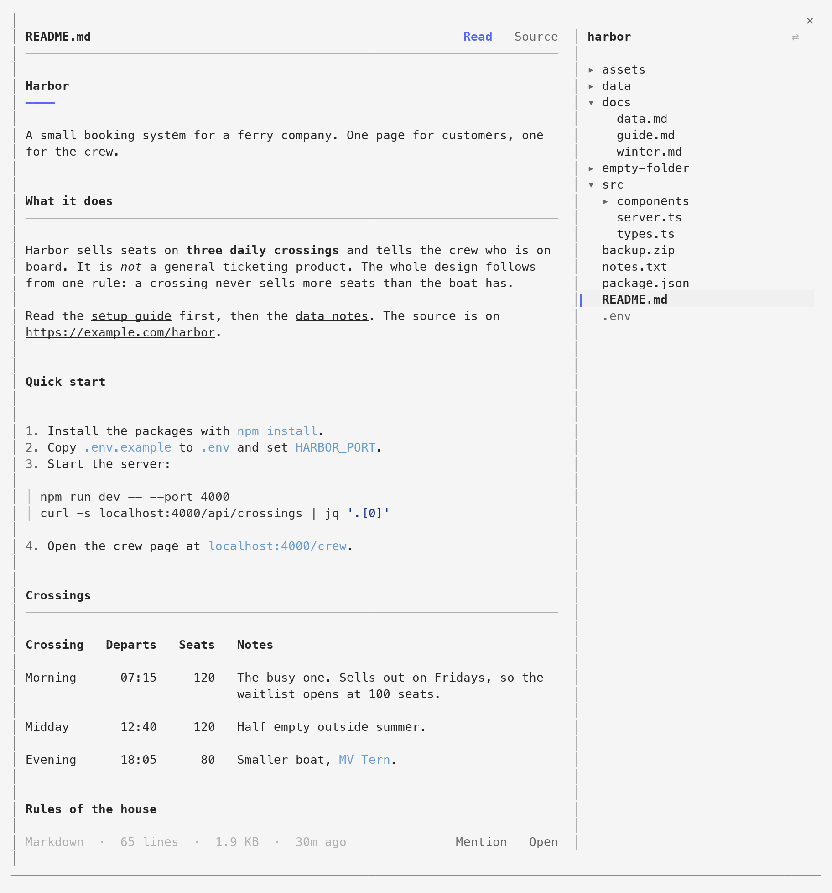
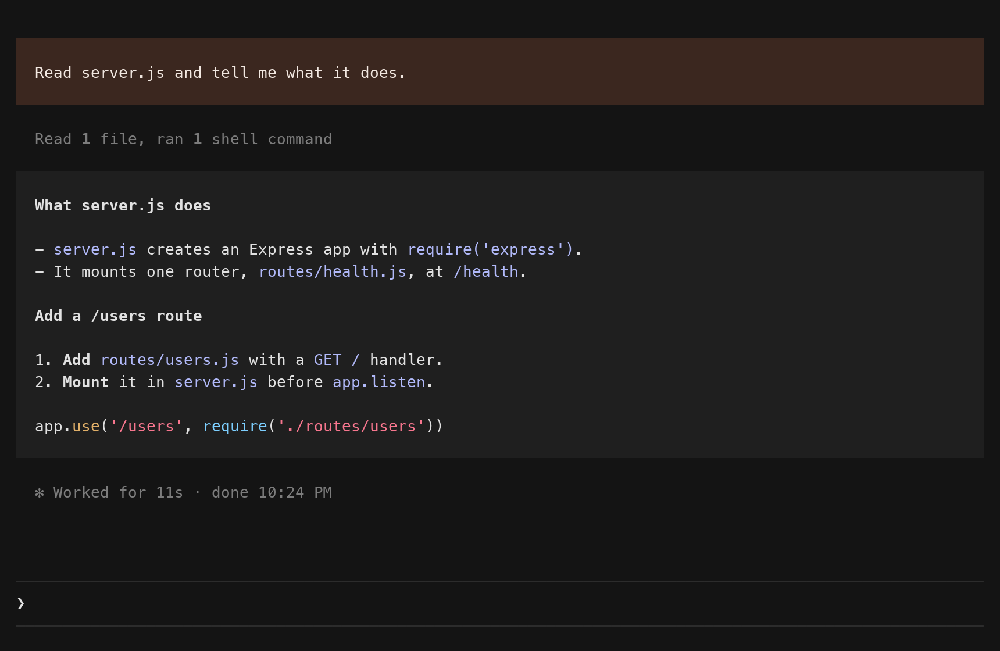

# cc-mods

Two mods for Claude Code. A mod changes Claude Code's own interface. Each one here is a folder of its own, and you install them one at a time.

## folio

`/files` opens a pane beside the chat with the files of your project. Markdown shows as a document, with headings, tables and paragraphs that wrap.



```
/plugin install folio --marketplace krishna-goutham-tls/cc-mods
```

More in [folio/README.md](folio/README.md).

## tint

Your message and Claude's reply show as blocks, in two looks, with a status line under the prompt. On macOS the colors follow dark and light.



```
/plugin install tint --marketplace krishna-goutham-tls/cc-mods
```

tint needs two more steps after the install, a line in `settings.json` and a pick in `/theme`. They are in [tint/README.md](tint/README.md).

## Install

Type the install line at the prompt of a Claude Code terminal session. Answer `y` to add the marketplace, then pick a scope. The user scope loads the mod in every session.

Both mods are built and tested on Claude Code 2.1.296. Mods are early access, so a later release of Claude Code can change the API and break them.

## Work on a mod

```sh
git clone https://github.com/krishna-goutham-tls/cc-mods
cd cc-mods
claude --plugin-dir folio
```

Claude Code loads the mod from the folder and reloads it when you save a file. `AGENTS.md` has the layout of the repo and the checks to run. Each mod has its own `AGENTS.md` and `TRACKER.md`.

## License

MIT
