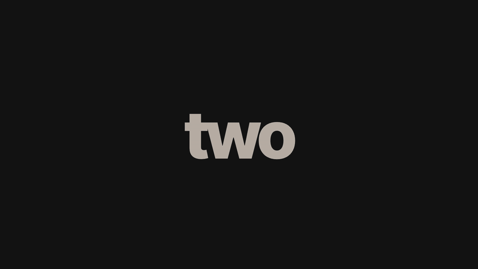
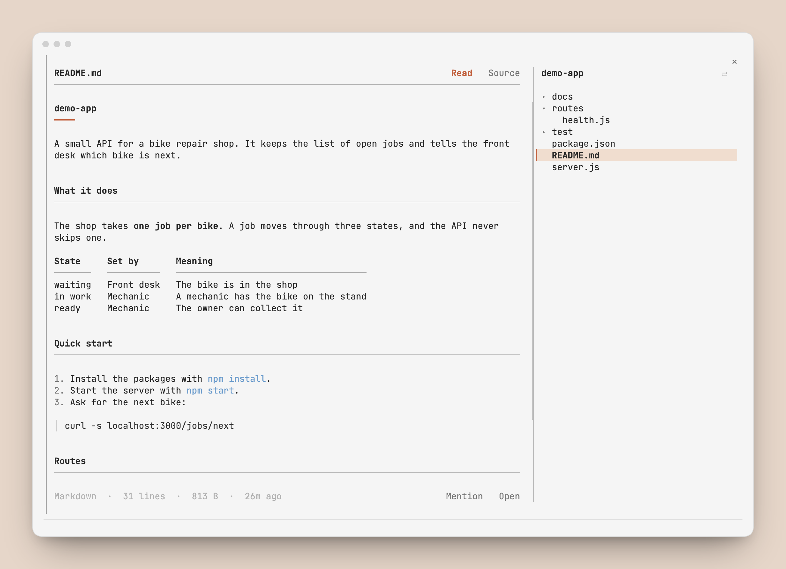
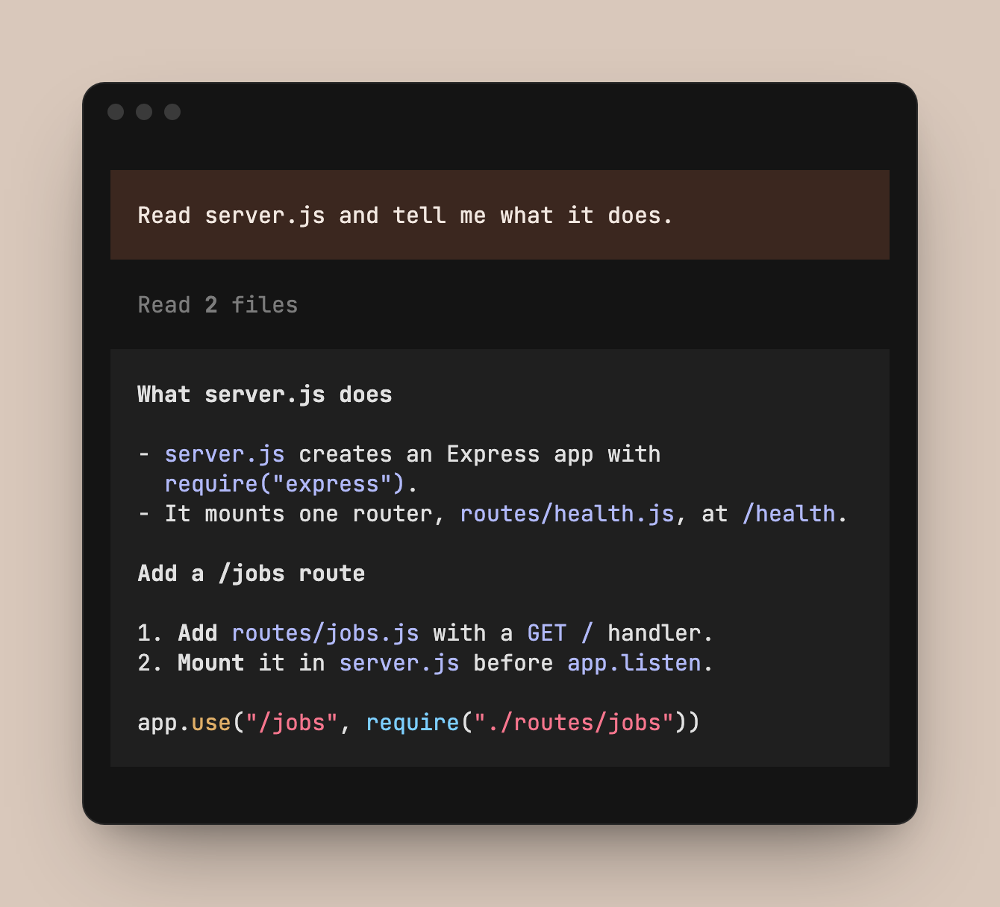
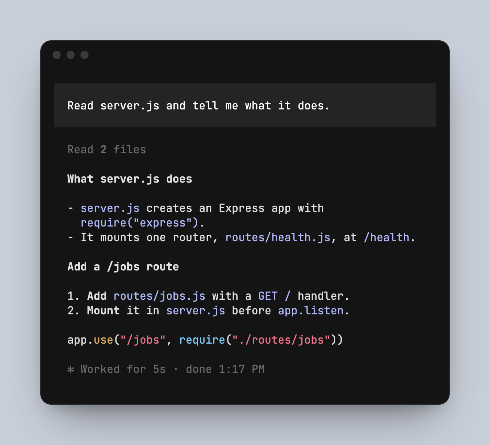
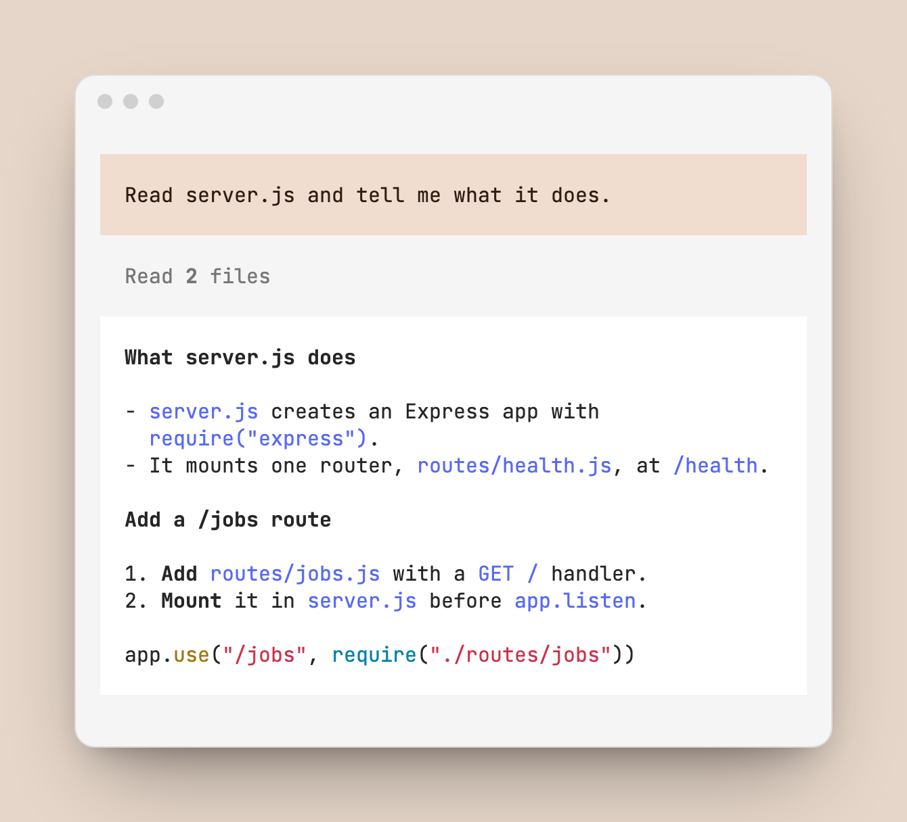
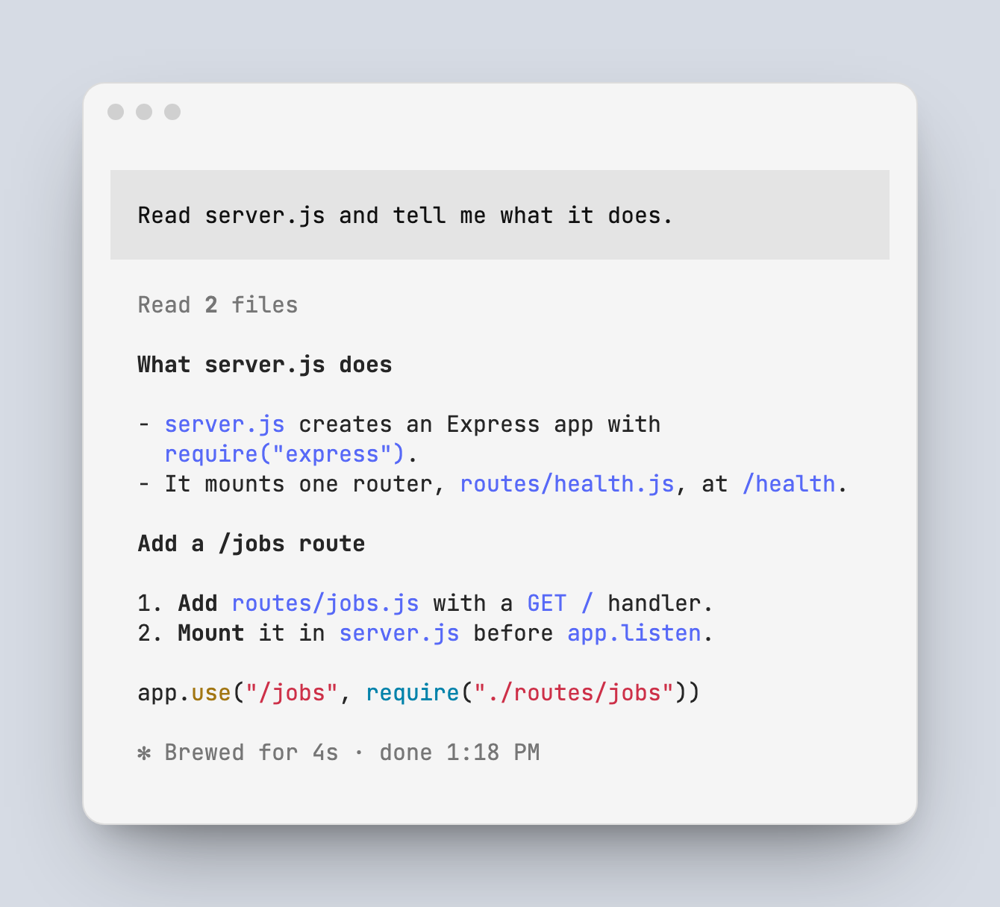
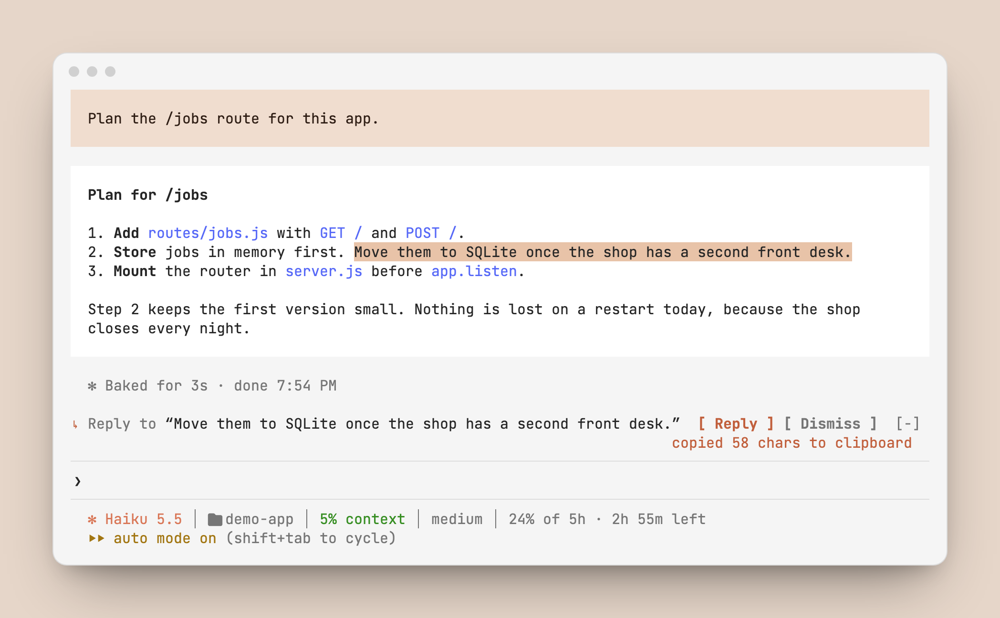
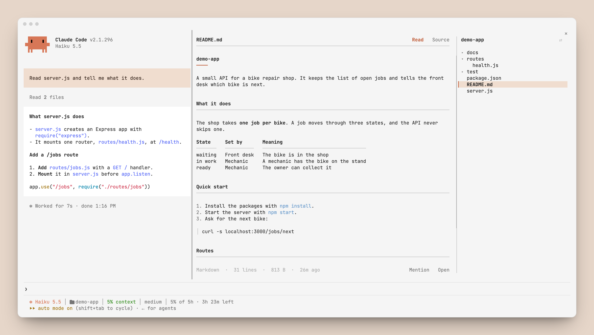

<p align="center">
  
</p>

<h1 align="center">cc-mods</h1>

<p align="center">
  Three mods for Claude Code.<br>
  <b>folio</b> shows the files of your project beside the chat. <b>tint</b> restyles the session. <b>reply</b> quotes part of an answer into your prompt.
</p>

<p align="center">
  <a href="#install">Install</a> ·
  <a href="#folio">folio</a> ·
  <a href="#tint">tint</a> ·
  <a href="#reply">reply</a> ·
  <a href="#which-mod-draws-what">Which mod draws what</a> ·
  <a href="#what-a-mod-can-reach">What a mod can reach</a>
</p>

<p align="center">
  <sub>The terminal pictures come from real sessions in a made-up project.</sub>
</p>

## Install

Type a line at the prompt of a Claude Code terminal session. Each mod installs alone.

```
/plugin install folio --marketplace krishna-goutham-tls/cc-mods
```

```
/plugin install tint --marketplace krishna-goutham-tls/cc-mods
```

```
/plugin install reply --marketplace krishna-goutham-tls/cc-mods
```

Answer `y` to add the marketplace, then pick a scope. The user scope loads the mod in every session.

- folio is ready after the install. Type `/files`.
- reply is ready after the install. Highlight part of an answer.
- tint needs two more steps: one line in `settings.json` for the status line, and a pick in `/theme`. They are in [tint/README.md](tint/README.md#turn-the-status-line-on).

## folio

<p align="center"></p>

`/files` opens a pane beside the chat. The document is next to the chat, and the file tree is at the right edge.

<p align="center">
  <picture>
    <source media="(prefers-color-scheme: dark)" srcset="docs/folio-dark.png">
    
  </picture>
</p>

| You do | The pane does |
|---|---|
| `/files` | Opens, and shows the README of the project |
| `/files docs/guide.md` | Opens that file and its folder |
| Click a file or a folder | Shows the file, or opens and closes the folder |
| Click `Read` or `Source` | Shows the formatted document, or the text as written |
| Click `Copy` | Puts the text of the open file on the clipboard |
| Click `Mention` | Puts `@path` in the prompt |
| Click `Open` | Opens the file in its Mac app |
| <kbd>ctrl</kbd>+<kbd>x</kbd> <kbd>tab</kbd> | Gives the pane the keyboard. <kbd>esc</kbd> returns to the prompt |

<details>
<summary>What it shows for each kind of file</summary>

<br>

| File | How |
|---|---|
| Markdown | Headings, paragraphs that wrap, lists, task lists, quotes, tables, code blocks with colours, front matter |
| Code and text | Claude Code's syntax colours, with line numbers |
| CSV and TSV | A table |
| PNG, JPG, GIF, HEIC | The picture, in a terminal with the kitty graphics protocol, such as Ghostty or kitty |
| PDF, Office files | The first page as a picture, made by macOS Quick Look |
| HTML, SVG | `Read` shows the top of the page as a picture, made by macOS Quick Look. `Source` shows the text |
| `.env`, keys, credentials | A notice. The text stays hidden until you click `Reveal`, so a shared screen or a recording is safe |
| Other files | The name and the size. `Open` shows the file in its own app |

A file that Claude writes gets a `●` in the tree.

</details>

More in [folio/README.md](folio/README.md).

## tint

<p align="center"></p>

Your message and Claude's reply show as blocks. The small rows around them start on the same left edge. A status line under the prompt shows the model, the folder, the git branch, the context used, the effort and the 5-hour usage.

<table>
  <tr>
    <td width="50%"></td>
    <td width="50%"></td>
  </tr>
  <tr>
    <td></td>
    <td></td>
  </tr>
  <tr>
    <td align="center"><sub><b>warm</b>: a brown block for you, a grey block for the reply, an orange accent</sub></td>
    <td align="center"><sub><b>grok</b>: a grey block for you, no block for the reply, a blue accent</sub></td>
  </tr>
</table>

You decide two things, and each has one switch.

| What | The switch |
|---|---|
| The look, warm or grok | `/tint` in any session. Every open session follows within 5 seconds |
| Dark or light | macOS. The mod reads the system setting every 5 seconds |

`/theme` lists one tint theme, "Tint (auto)". You pick it once.

More in [tint/README.md](tint/README.md).

## reply

Highlight part of Claude's answer and click `Reply`. The text goes into your prompt as a quote, and you type your reply under it. It works like the reply on a chat message.

<p align="center">
  <picture>
    <source media="(prefers-color-scheme: dark)" srcset="reply/docs/reply-dark-1.png">
    
  </picture>
</p>

| You do | The mod does |
|---|---|
| Highlight text | Shows `↳ Reply to "…"  [ Reply ] [ Dismiss ]` above the prompt |
| Click `Reply` | Puts the text in the prompt as a `>` quote. A draft in the prompt stays |
| Click `Dismiss` | Hides the row until you highlight something new |
| Highlight more and click again | Stacks the next quote under the first |

More in [reply/README.md](reply/README.md).

## Which mod draws what

<p align="center">
  <picture>
    <source media="(prefers-color-scheme: dark)" srcset="docs/both-dark.png">
    
  </picture>
</p>

<p align="center">
  <sub>This picture follows your GitHub theme, the way tint follows macOS.</sub>
</p>

```text
┌─ chat ────────────────────┬─ document ──────────────────┬─ tree ────────┐
│                           │ README.md      Read  Source │ demo-app    ⇄ │
│ ▓ your message ▓▓▓▓▓▓▓▓▓▓ │                             │ ▸ docs        │
│                           │ headings, tables, lists,    │ ▾ routes      │
│ ░ Claude's reply ░░░░░░░░ │ code, pictures, CSV         │     health.js │
│ ░░░░░░░░░░░░░░░░░░░░░░░░░ │                             │ ▎ README.md   │
│                           │                             │   server.js   │
│ ✻ Worked for 8s           │               Mention  Open │               │
├───────────────────────────┴─────────────────────────────┴───────────────┤
│ ❯                                                                       │
│ ✻ Opus │ demo-app │ main │ 21% context │ medium │ 5% of 5h              │
└─────────────────────────────────────────────────────────────────────────┘
 └────────── tint ─────────┘└─────────────────── folio ──────────────────┘
   and the status line under the prompt
```

Everything else in the window is Claude Code's own: the header, the prompt box, the tool rows.

## What a mod can reach

A mod runs inside Claude Code, so it is fair to ask what these three do.

| | folio | tint | reply |
|---|---|---|---|
| Reads | Files under the project folder, to show them in the pane | Its own files in `~/.claude`, and the `theme` setting | What you highlight in the terminal, and the prompt box |
| Writes | Nothing in your project | Three files in `~/.claude`: `themes/tint.json`, `tint/active`, `tint/statusline.sh` | The prompt box, only when you press `Reply`. Never sends it |
| Network | No call | No call | No call |
| The model | The text of a file does not go to the model | `/tint` does not call the model | Does not call the model |
| Tool calls | Watches Edit and Write to mark the files Claude wrote. Changes and blocks none | Touches none | Touches none |
| Programs it runs | `sips`, `qlmanage`, `mkdir`, `mv`, `open` | `defaults`, `mv` | None |
| `settings.json` | Never writes it | Never writes it. You add the status line yourself | Never writes it |

`claude plugin validate folio`, `claude plugin validate tint` and `claude plugin validate reply`, run from the root of the repo, print the calls from the source.

## Before you install

- folio and tint are built and tested on Claude Code 2.1.296, and reply on 2.1.300. Mods are early access, so a later release of Claude Code can change the API and break them.
- All three are for the terminal. The Claude Desktop app is out of scope on purpose: tint and reply do nothing there, and folio opens with a plain tree.
- macOS is the only system they have run on. tint has not been run on Linux or Windows.
- folio only reads. There is no edit mode yet.
- tint takes dark or light from macOS, so your terminal must follow macOS too. If the two disagree, the reply in the warm look is hard to read.

## Work on a mod

```sh
git clone https://github.com/krishna-goutham-tls/cc-mods
cd cc-mods
claude --plugin-dir folio
```

Claude Code loads the mod from the folder and reloads it when you save a file. tint needs a copy and one more step, which are in [tint/README.md](tint/README.md#work-on-it).

`AGENTS.md` has the layout of the repo and the checks to run. Each mod has its own `AGENTS.md` and `TRACKER.md`.

## License

MIT
