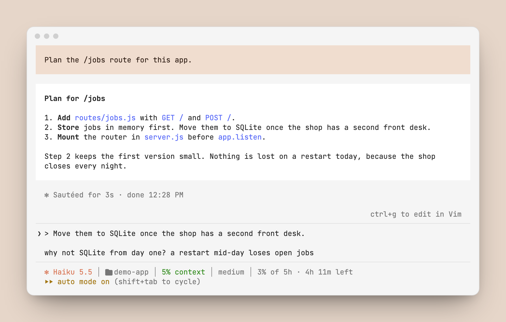

# reply

A Claude Code mod for the terminal. Highlight part of Claude's answer, press `1`, and the text goes into your prompt as a quote. You type your reply under it and send.

<p align="center">
  <picture>
    <source media="(prefers-color-scheme: dark)" srcset="docs/reply-dark-1.png">
    
  </picture>
</p>

<p align="center">
  <picture>
    <source media="(prefers-color-scheme: dark)" srcset="docs/reply-dark-2.png">
    
  </picture>
</p>

The pictures are from a test terminal, on a made-up project called demo-app.

## How it works

| You do | The mod does |
|---|---|
| Highlight text with the mouse | Shows a row above the prompt: `↳ Reply to "…"  1: Reply` |
| Press `1` in an empty prompt | Puts the text in the prompt as a `>` quote, with a blank line under it for your words |
| Click `Reply` | The same. Use the click when the prompt already has a draft: the draft stays, and the quote goes under it |
| Highlight more text and press again | Adds the next quote under the first one, so one prompt can answer several parts |
| Send the prompt | The row goes away |

The mod never sends a prompt. It puts text in the prompt box, and you send it.

## Install

In a Claude Code terminal session:

```
/plugin install reply --marketplace krishna-goutham-tls/cc-mods
```

## Before you install

- Terminal only, in the fullscreen layout. Claude Code tells a mod what you highlighted only there. `/tui fullscreen` turns it on.
- Claude Code raises no event when you highlight text, so the mod checks for a highlight 4 times a second. It reads only the highlight.
- A highlight made only to copy text also shows the row. The row stays until you send your next prompt.
- Built and tested on Claude Code 2.1.300. Mods are early access, so a later release can change the API and break the mod.

## License

MIT
