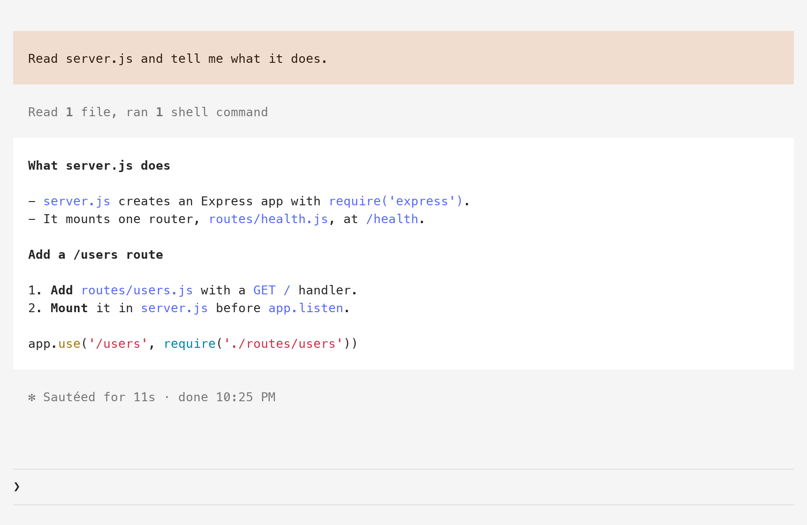
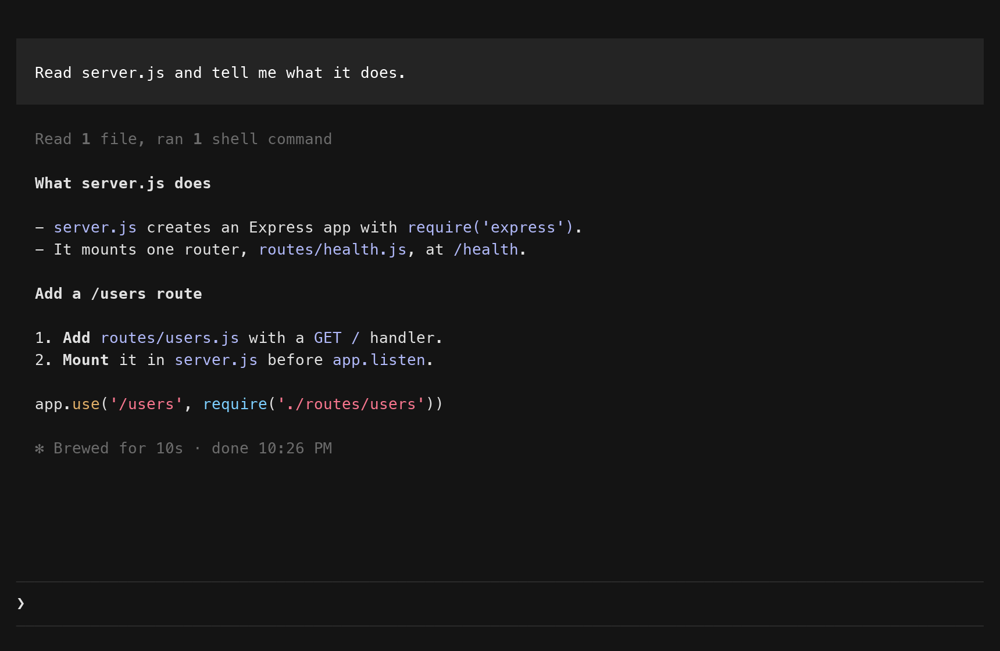
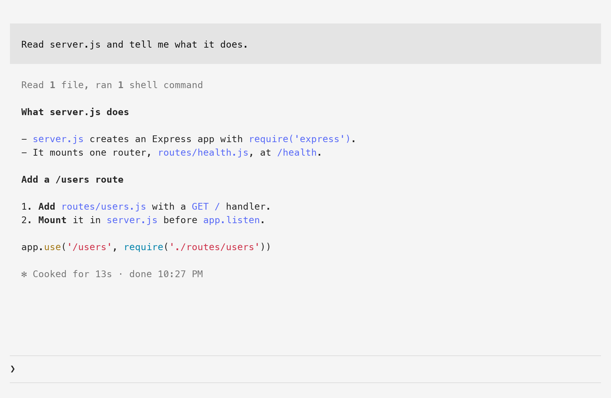
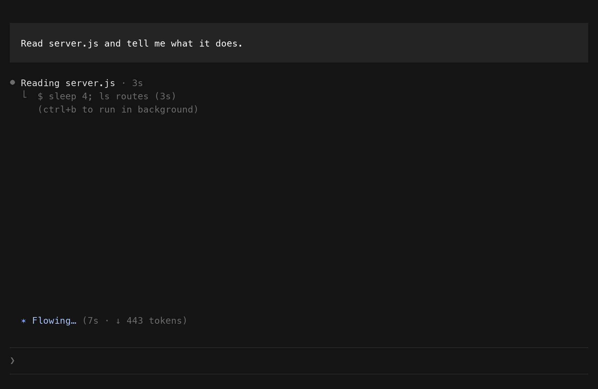
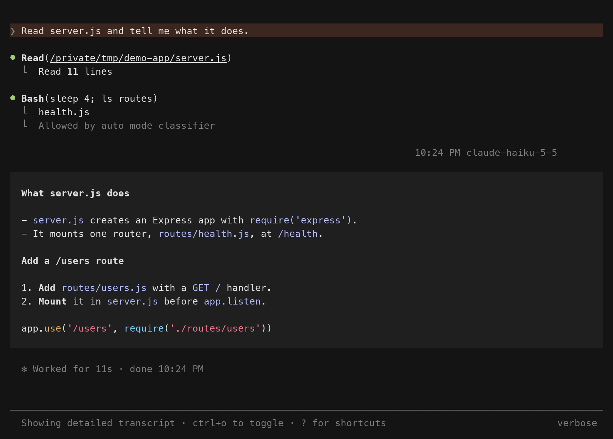

# tint

A Claude Code mod that restyles the terminal session. Your message and Claude's reply show as blocks, the small rows around them start on the same left edge, and a status line under the prompt shows the model, the folder and how much context is used.

| Warm dark | Warm light |
|---|---|
|  |  |

| Grok dark | Grok light |
|---|---|
|  |  |

The pictures are from a test terminal that draws in Menlo, on a made-up project called demo-app.

## What you get

- Two looks. Warm has a brown block for your message, a grey block for the reply and an orange accent. Grok has a grey block for your message, no block for the reply and a blue accent.
- A dark and a light set of colors for each look. On macOS the mod follows the system setting.
- `/tint`, which switches the look in every open session.
- A status line: model, folder, git branch, context used, effort and 5-hour usage.


## Install

In a Claude Code terminal session:

```
/plugin install tint --marketplace krishna-goutham-tls/cc-mods
```

Answer `y` to add the marketplace, then pick a scope. The user scope loads tint in every session.

Then start a new session. At the start of a session the mod puts two files in Claude Code's config folder, `~/.claude`:

- `themes/tint.json`, the theme you pick in the next step but one.
- `tint/statusline.sh`, a copy of the status line script.

The session looks the same as before until you pick the theme.

## Turn the status line on

Add one line to `~/.claude/settings.json`:

```json
"statusLine": { "type": "command", "command": "bash ~/.claude/tint/statusline.sh" }
```

The mod itself lives in a folder that has its version in the path, so that path changes with every update. `~/.claude/tint/statusline.sh` stays the same. The mod copies the script there at the start of a session, and copies it again when an update changes it.

The status line works without the theme, and the theme works without the status line.

## Pick the theme

Type `/theme` and choose "Tint". Claude Code stores the choice as `custom:tint`.

Claude Code does not let a mod set a custom theme, so you pick it once by hand. From then on the mod rewrites the theme's file, `~/.claude/themes/tint.json`, when the look or the mode changes. Claude Code reads a theme file again when it changes, in every open session.

The four sets also work as fixed themes: `custom:tint:tint-warm-dark`, `custom:tint:tint-warm-light`, `custom:tint:tint-grok-dark` and `custom:tint:tint-grok-light`. A fixed theme holds one look and one mode. The mod draws the blocks for it and writes no file. To use one, set it as `"theme"` in `~/.claude/settings.json`.

With any other theme the session looks standard.

## /tint

| You type | What happens |
|---|---|
| `/tint`, `/tint next` | Switches to the other look |
| `/tint warm`, `/tint grok` | Switches to that look |

The answer is one line with the look and the mode, for example `grok dark`. The blocks and the colors change in every open session within 5 seconds, and the status line follows.

`/tint` works while the theme is "Tint". With another theme it answers `pick Tint in /theme first`.

Running `/tint` does not call the model. Claude Code keeps the command and its one line of output in the conversation, so Claude reads them with your next prompt. That is a few dozen tokens for each run.

## Dark and light

On macOS the mod asks the system for the mode at the start of a session and then every 5 seconds, with `defaults read -g AppleInterfaceStyle`. When the mode or the look has changed, it writes `tint.json` again. The mod API has no event for a change of mode, so the mod polls. It writes nothing while the file is already right.

On Linux there is no `defaults` command. The mod keeps the mode that `tint.json` already holds, and a new `tint.json` is dark. `/tint` still switches the look. For the light colors, use one of the two fixed light themes from the section above.

On Windows the mod needs `HOME` and the `mv` command, which Git Bash and WSL have. Without them it writes nothing and draws only for the four fixed themes. The status line script needs `bash`.

tint has not been run on Linux or Windows. The two paragraphs above come from the code and its tests.

## Requirements

- Claude Code 2.1.296. tint is built and tested on that version.
- A terminal with 24-bit color. The theme colors are hex values.
- For the folder and branch icons in the status line, a Nerd Font, or a terminal that has those symbols built in, such as Ghostty. Without one the two icons do not draw and the rest of the line is fine.
- `jq` is optional. The status line script uses `jq` when it finds it and `python3` when it does not.

## What tint cannot change

- The logo and header at the top of a session, and the prompt box. A mod has no way to draw them. The theme sets the color of the prompt box's border and nothing else there.
- The colors inside a reply. Claude Code's markdown renderer draws headings bold in the terminal's text color, inline code in a fixed blue, and code fences in the terminal's ANSI colors. The theme files do not reach them.
- The row that repeats a slash command you typed. Claude Code draws it with a highlight as wide as the text. The mod restyles only the output under it.
- The left edge of a tool row. Its text already starts on the text edge, and the mark in front of it stands in the two columns to the left.



The `ctrl+o` view keeps the standard drawing for your message and the tool rows.



## Early access

The mod API of Claude Code is early access. A later release can change it and break tint. If a session looks wrong after an update, pick another theme in `/theme` and the mod stops drawing.

## What it can reach

A mod runs inside Claude Code, so it is fair to ask what this one does.

- It writes three files, all in Claude Code's config folder: `themes/tint.json`, `tint/active`, which holds the look, and `tint/statusline.sh`. It writes a draft of `tint.json` next to `tint/active` and moves it into place with `mv`.
- It reads those files, the `theme` setting, and its own `themes/` and `statusline/` folders.
- It runs two programs: `defaults`, to ask macOS for the mode, and `mv`.
- It makes no network call, reads nothing in your project and changes no tool call.
- It never writes `settings.json`.

`claude plugin validate tint`, run from the root of the repo, prints the calls from the source.

The config folder is `~/.claude`, or the folder in `CLAUDE_CONFIG_DIR` when Claude Code was started with one. The status line script reads `~/.claude` only.

## How it works

- `themes/` has the four sets of colors. `tint.json` always holds one of them with the name set to "Tint". To change a color, change it in these four files.
- `hooks/register.tsx` has the hooks: the blocks, `/tint`, and the timer that keeps `tint.json` in step.
- `hooks/palette.ts` has the two colors that no theme key holds: the text color in your block and the fill of the reply.
- `statusline/statusline.sh` reads the session JSON on stdin and prints one line. The field list is at https://code.claude.com/docs/en/statusline.

Every open session runs the same timer. Each one computes the same text for `tint.json` from the look file, the mode and the four source files, so two sessions write the same bytes. If two sessions disagree about the mode, each writes once and then leaves the file alone for 60 seconds.

The mod draws three rows itself: your prompt, Claude's reply and the output of a slash command. Claude Code's own markdown renderer draws the reply inside the block, so tables, code fences and links work as before. The spinner and the line that ends a turn keep the standard drawing and move two columns right. A task notification, a message from another agent and an error line keep the standard drawing.

## Work on it

tint is one of two mods in the `cc-mods` repo. Its folder is `tint/`.

```sh
git clone https://github.com/krishna-goutham-tls/cc-mods
cd cc-mods/tint
claude --plugin-dir . --settings '{"theme":"custom:tint:tint-warm-dark"}'
```

The `--settings` part forces a fixed theme for that session, so the mod writes no theme file while you try a change. `AGENTS.md` says why that matters.

```sh
claude plugin validate .
claude plugin test .
npx -p typescript tsc -p .
```

Test the status line by hand:

```sh
echo '{"model":{"display_name":"Opus"},"workspace":{"current_dir":"'"$PWD"'"},"context_window":{"used_percentage":25}}' | statusline/statusline.sh
```

Open work is in `TRACKER.md`.

## License

MIT
